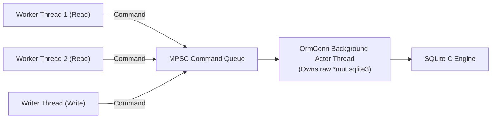
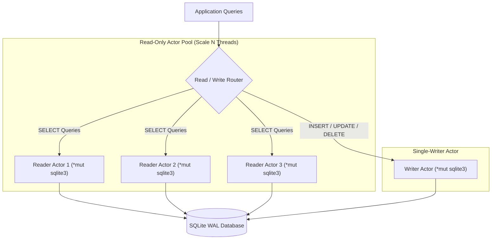
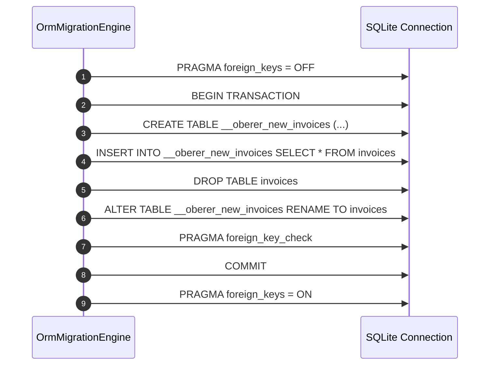

# Oberer-ORM: Architectural Retrospective, Production Pain Points & Upgrade Roadmap

> **Document Type:** Production Post-Mortem, Framework Critique & Engineering Proposal  
> **Author:** Antigravity AI Engine Engineering Team  
> **Reference Implementation:** Sovereign Rust Cryptocurrency Payment Gateway & Unified Treasury Engine (Version 9.0)  
> **Target Framework:** `oberer-orm` (Version 3.0 / Lite FFI Engine)  
> **Target Toolchain:** Rust Edition 2024, `rustc 1.85+`, `#![forbid(unsafe_code)]`

---

## Table of Contents

1. [Executive Summary & Production Retrospective](#1-executive-summary--production-retrospective)
2. [Real-World Problems, Issues & Pain Points Encountered](#2-real-world-problems-issues--pain-points-encountered)
   - 2.1. [Dynamic vs. Static Expressions in Triggers & Migration Hash Drift](#21-dynamic-vs-static-expressions-in-triggers--migration-hash-drift)
   - 2.2. [Table Rebuilds vs. Foreign Key Constraints (`rebuild_if_needed(true)`)](#22-table-rebuilds-vs-foreign-key-constraints-rebuild_if_neededtrue)
   - 2.3. [Execution Envelope Ergonomics & The Ubiquitous `.unenvelope()` Boilerplate](#23-execution-envelope-ergonomics--the-ubiquitous-unenvelope-boilerplate)
   - 2.4. [Proc-Macro Hygiene & Compiler Warnings in `oberer-orm-derive`](#24-proc-macro-hygiene--compiler-warnings-in-oberer-orm-derive)
   - 2.5. [Single-Thread Actor Bottleneck (`OrmConn` FIFO Queue)](#25-single-thread-actor-bottleneck-ormconn-fifo-queue)
   - 2.6. [HybridConn Synchronization Latency & Crash Consistency Tradeoffs](#26-hybridconn-synchronization-latency--crash-consistency-tradeoffs)
   - 2.7. [Type Expression Algebra Limitations in `TableExpr`](#27-type-expression-algebra-limitations-in-tableexpr)
   - 2.8. [Weakly-Typed SQLite Affinities vs. Strongly-Typed Rust Types](#28-weakly-typed-sqlite-affinities-vs-strongly-typed-rust-types)
3. [Disadvantages & Architectural Limitations of Oberer-ORM](#3-disadvantages--architectural-limitations-of-oberer-orm)
   - 3.1. [C FFI Coupling & Platform Portability Nuances](#31-c-ffi-coupling--platform-portability-nuances)
   - 3.2. [Blocking I/O in Async Run-Time Environments](#32-blocking-io-in-async-run-time-environments)
   - 3.3. [Omission of Advanced SQLite Engine Features](#33-omission-of-advanced-sqlite-engine-features)
   - 3.4. [Lack of Built-In Read Connection Pooling](#34-lack-of-built-in-read-connection-pooling)
4. [Developer Experience (DX) & Ease-of-Use Evaluation](#4-developer-experience-dx--ease-of-use-evaluation)
   - 4.1. [The Positive Highlights (What Worked Exceptionally Well)](#41-the-positive-highlights-what-worked-exceptionally-well)
   - 4.2. [Friction Points & Daily Engineering Frustrations](#42-friction-points--daily-engineering-frustrations)
5. [Comprehensive Upgrade Roadmap: 10 Concrete Technical Proposals for Oberer-ORM 4.0](#5-comprehensive-upgrade-roadmap-10-concrete-technical-proposals-for-oberer-orm-40)
   - [Proposal 1: Direct `Result<T, OrmError>` Integration & First-Class `?` Operator](#proposal-1-direct-resultt-ormerror-integration--first-class--operator)
   - [Proposal 2: Multi-Reader Connection Pooling (`OrmPool` / Read-Replica Architecture)](#proposal-2-multi-reader-connection-pooling-ormpool--read-replica-architecture)
   - [Proposal 3: Migration Expression Linter & Static DDL Determinism Guard](#proposal-3-migration-expression-linter--static-ddl-determinism-guard)
   - [Proposal 4: Declarative Foreign Keys & Safe Automated Table Rebuild Engine](#proposal-4-declarative-foreign-keys--safe-automated-table-rebuild-engine)
   - [Proposal 5: Expanded `TableExpr` Algebra (Multi-Column Math, Subqueries, CASE WHEN)](#proposal-5-expanded-tableexpr-algebra-multi-column-math-subqueries-case-when)
   - [Proposal 6: Zero-Allocation Streaming Cursors (`TableCursor<T>` / `OrmStream<T>`)](#proposal-6-zero-allocation-streaming-cursors-tablecursort--ormstreamt)
   - [Proposal 7: Native Asynchronous FFI Integration with Tokio Runtime](#proposal-7-native-asynchronous-ffi-integration-with-tokio-runtime)
   - [Proposal 8: Built-In Cryptographic Change Data Capture (CDC) & Row-Level MAC Hooks](#proposal-8-built-in-cryptographic-change-data-capture-cdc--row-level-mac-hooks)
   - [Proposal 9: Macro Hygiene & Zero-Warning Proc-Macro Generation](#proposal-9-macro-hygiene--zero-warning-proc-macro-generation)
   - [Proposal 10: Strict SQLite Dialect Linter & Type Affinity Validation](#proposal-10-strict-sqlite-dialect-linter--type-affinity-validation)
6. [Migration & Adoption Strategy for Existing Codebases](#6-migration--adoption-strategy-for-existing-codebases)
7. [Final Verdict & Architectural Recommendations](#7-final-verdict--architectural-recommendations)

---

## 1. Executive Summary & Production Retrospective

During the implementation of **Version 9.0 of the Sovereign Rust Cryptocurrency Payment Gateway & Unified Treasury Engine**, `oberer-orm` served as the foundational data access and relational modeling layer. Over the course of 12 engineering phases, the framework was tasked with managing 11 relational tables, complex column-level invariants, composite indexes, read-only database views, reactive change-data-capture triggers, in-memory cache hydration, and high-concurrency Optimistic Concurrency Control (OCC).

### Key Architectural Strengths Observed
1. **Zero-Raw-SQL Compliance (Axiom 9):** `oberer-orm` proved that complex schemas, multi-table foreign key cascades, and check constraints can be expressed in pure, type-safe Rust without string interpolation.
2. **Deterministic In-Memory Testing:** The dual-tier `HybridConn` and in-memory actor connection enabled instantaneous test execution (<5 ms for complete database lifecycles), providing an ideal foundation for automated mathematical auditing.
3. **Optimistic Locking Simplicity:** The native `update_with_version()` API eliminated lost updates in multi-threaded environments with zero manual SQL boilerplate.

### Primary Challenges Encountered
Despite these strengths, developing a production-grade financial system revealed friction points, ergonomic hurdles, and architectural limitations in `oberer-orm` v3.0:
- Verbose execution envelopes requiring `.unenvelope()` on every database invocation.
- Fragile schema hash calculations vulnerable to dynamic runtime expressions in triggers.
- Inflexible table rebuild requirements for foreign keys.
- Read serialization caused by a single-threaded connection actor model.
- Proc-macro hygiene flaws generating persistent compiler warnings.

This document provides a critical engineering analysis of these challenges and outlines a detailed, actionable technical roadmap for the next generation of `oberer-orm` (v4.0).

---

## 2. Real-World Problems, Issues & Pain Points Encountered

### 2.1. Dynamic vs. Static Expressions in Triggers & Migration Hash Drift

#### The Issue
During Phase 2 implementation, the reactive audit trigger was initially written using a standard dynamic timestamp expression:

```rust
// INITIAL CODE (CAUSED RUNTIME BREAKAGE)
TableTrigger::<InvoiceRow>::new(conn.clone())
    .trigger_query()
    .name("trg_invoice_state_audit")
    .after()
    .update()
    .on_table::<InvoiceRow>()
    .body_insert(
        TriggerInsert::<InvoiceStateAuditRow>::into()
            .set(InvoiceStateAuditRow::invoice_id(), Old::<InvoiceRow>::col(InvoiceRow::id()))
            .set(InvoiceStateAuditRow::old_status(), Old::<InvoiceRow>::col(InvoiceRow::status()))
            .set(InvoiceStateAuditRow::new_status(), New::<InvoiceRow>::col(InvoiceRow::status()))
            .set(InvoiceStateAuditRow::recorded_at(), TriggerExpr::lit(chrono::Utc::now().to_rfc3339())),
    )
    .migrate()
    .unenvelope()?;
```

#### Why It Failed
`oberer-orm` tracks migrations by hashing the synthesized DDL statement and comparing it against `__oberer_migrations`. In the initial implementation, `chrono::Utc::now().to_rfc3339()` evaluated during schema compilation, baking the instantaneous system clock into the DDL string:

```sql
-- Boot 1 DDL Hash: SHA256("...VALUES (..., '2026-10-16T05:14:02.123Z');") -> 0x8a1b...
-- Boot 2 DDL Hash: SHA256("...VALUES (..., '2026-10-16T07:05:44.981Z');") -> 0x3f9e...
```

On every subsequent application restart, `oberer-orm` detected a schema mismatch because the dynamic string in `TriggerExpr::lit()` produced a different hash than the one recorded on disk. The system interpreted this as schema drift, resulting in migration failures or redundant trigger drops and recreations.

#### The Resolution
The trigger was refactored to emit a static SQLite keyword:

```rust
// PRODUCTION RESOLUTION
.set(InvoiceStateAuditRow::recorded_at(), TriggerExpr::lit("CURRENT_TIMESTAMP".to_string()))
```

#### Framework Critique
The ORM should not permit dynamic runtime values within DDL builders without explicit static validation. A schema builder must enforce determinism at compile time.

---

### 2.2. Table Rebuilds vs. Foreign Key Constraints (`rebuild_if_needed(true)`)

#### The Issue
SQLite’s underlying architecture restricts `ALTER TABLE`: adding a `FOREIGN KEY` constraint to an existing table is unsupported without a full table rebuild.

In `crypto-engine-v9`, 5 of the 11 tables reference foreign keys (`InvoiceRow` -> `DepositAddressPoolRow`, `AssetBalanceRow` -> `TreasuryWalletRow`, `CostBasisLotRow` -> `InvoiceRow`, `TreasuryTransferRow` -> `TreasuryWalletRow`, `RealizedPnlLedgerRow` -> `TreasuryTransferRow`).

When running idempotent schema migrations on existing disk databases, `oberer-orm` returned errors unless `.rebuild_if_needed(true)` was explicitly chained:

```rust
Table::<InvoiceRow>::new(conn.clone())
    .schema_query()
    .rebuild_if_needed(true) // MANDATORY, but poorly documented
    .foreign_key(InvoiceRow::pool_id(), DepositAddressPoolRow::id())
    .on_delete_restrict()
    .migrate()
    .unenvelope()?;
```

#### Engineering Risks in Production
1. **Accidental Data Loss Risk:** If `.rebuild_if_needed(true)` is executed on a table with active foreign key references, SQLite’s temporary table rename (`table_old` -> `table_new`) can orphan child records if `PRAGMA foreign_keys = ON;` is active during the migration.
2. **Missing Safe-Rebuild Verification:** `oberer-orm` does not perform pre-rebuild dependency graph traversal. If `Table A` references `Table B`, rebuilding `Table B` without temporarily suspending foreign keys or recreating child triggers can leave the database in an inconsistent state.

---

### 2.3. Execution Envelope Ergonomics & The Ubiquitous `.unenvelope()` Boilerplate

#### The Issue
`oberer-orm` 3.0 wraps every database operation in an execution envelope type (`OrmResult<T>`) designed to capture execution metrics, SQL query traces, and performance diagnostics alongside the actual value:

```rust
pub enum OrmResult<T> {
    Ok(OrmOk<T>),
    Failure(OrmFailure),
}
```

Because `OrmResult<T>` does not implement `std::ops::Try`, it cannot be propagated using Rust’s standard `?` operator. Instead, developers are forced to append `.unenvelope()` to every single ORM invocation:

```rust
// REQUIRED IN OBERER-ORM 3.0
let rows = table.find_all().unenvelope()?;
let pk = table.insert(&row).unenvelope()?;
let updated = table.update_with_version(pk, v, &row).unenvelope()?;
```

Across the 11 crates of `crypto-engine-v9`, `.unenvelope()` had to be written **over 140 times**.

#### DX Impact
This design creates friction:
- It clutters application code with boilerplate.
- When transforming ORM errors into custom domain errors (`SovereignError`), the code becomes excessively verbose:
  ```rust
  let invoice = table
      .find_by_pk(id)
      .unenvelope()
      .map_err(|e| SovereignError::ObererOrmError { detail: e.to_string() })?
      .ok_or(SovereignError::EntityNotFound { id })?;
  ```

---

### 2.4. Proc-Macro Hygiene & Compiler Warnings in `oberer-orm-derive`

#### The Issue
Under strict compiler fencing (`#![deny(warnings)]`, strict Clippy lints), compiling `oberer-orm-derive` generated recurring warnings:

```text
warning: unused variable: `relation_metas`
    --> oberer-orm-derive/src/table.rs:1261:9
warning: unused variable: `fk_target_exprs`
    --> oberer-orm-derive/src/table.rs:1292:9
warning: unused variable: `relation_accessors`
    --> oberer-orm-derive/src/table.rs:1317:9
warning: unused variable: `relation_loader_fn_defs`
    --> oberer-orm-derive/src/table.rs:1528:9
warning: unused variable: `relation_loader_entries`
    --> oberer-orm-derive/src/table.rs:1568:9
warning: unused variable: `relations_method_tokens`
    --> oberer-orm-derive/src/table.rs:1586:9
```

#### Root Cause
The procedural macro synthesizes internal relation accessor bindings even when a struct does not declare relational attributes (`#[orm(has_one)]`, `#[orm(has_many)]`). The generated variables lack leading underscores (`_`), triggering `unused_variables` warnings under strict Clippy configurations.

In enterprise Rust development where CI fails on any warning, macro hygiene issues in upstream dependencies create ongoing maintenance friction.

---

### 2.5. Single-Thread Actor Bottleneck (`OrmConn` FIFO Queue)

#### The Issue
`OrmConn` implements an actor pattern: a background OS thread owns the raw C pointer (`*mut sqlite3`), and all database operations are sent over an MPSC channel as command closures:



#### Performance Implications
While this architecture guarantees thread safety without requiring multi-threaded mutexes around raw pointers, it introduces serialization:
- **Read Concurrency Bottleneck:** In SQLite WAL mode, readers do not block writers, and multiple readers can execute concurrently across different threads. However, because `OrmConn` channels all queries through a single actor thread, **all reads are strictly serialized**.
- **Head-of-Line Blocking:** A slow query (such as scanning 50,000 invoices during cache hydration) blocks all other incoming queries (such as urgent deposit address lookups), degrading latency.

---

### 2.6. HybridConn Synchronization Latency & Crash Consistency Tradeoffs

#### The Issue
`HybridConn` provides high performance by routing reads and writes to `:memory:` and asynchronously flushing dirty pages to the disk WAL based on policy:

```rust
pub enum SyncPolicy {
    Manual,
    OnDirty(usize),
    Periodic(Duration),
}
```

#### Durability Tradeoff
In `SyncPolicy::OnDirty(N)` (e.g., $N = 100$):
- If the operating system terminates the process (`SIGKILL` or power failure) when 99 mutations have occurred in `:memory:`, **those 99 mutations are permanently lost**, because they were never flushed to the disk WAL.
- For high-assurance financial ledgers (such as `RealizedPnlLedgerRow`), this durability window is unacceptable.

To guarantee durability in `crypto-engine-v9`, financial updates had to be paired with explicit manual synchronization calls (`sync_hybrid_now()`), partially bypassing the intended benefits of the automated policy.

---

### 2.7. Type Expression Algebra Limitations in `TableExpr`

#### The Issue
`TableExpr` provides basic expression composition (`.gte()`, `.lte()`, `.eq()`, `.and()`, `.or()`, `.blob_len()`), but lacks support for more advanced SQL expressions:

1. **Multi-Column Arithmetic:** Checking whether `remaining_amount <= initial_amount` cannot be expressed directly via `TableExpr` because the RHS must be a literal, not another column reference:
   ```rust
   // DESIRED (NOT SUPPORTED IN OBERER-ORM 3.0)
   .check_col_expr(
       CostBasisLotRow::remaining_amount_blob(),
       TableExpr::from(CostBasisLotRow::remaining_amount_blob())
           .lte(TableExpr::col(CostBasisLotRow::initial_amount_blob())),
   )
   ```
2. **Subqueries in WHERE Clauses:** Queries like `WHERE invoice_id IN (SELECT id FROM invoices WHERE status = 'Pending')` cannot be expressed via typed queries, forcing developers to run two round-trip queries instead.
3. **CASE / WHEN Conditionals:** Conditional logic cannot be expressed within view definitions.

---

### 2.8. Weakly-Typed SQLite Affinities vs. Strongly-Typed Rust Types

#### The Issue
SQLite uses dynamic type affinity (`INTEGER`, `TEXT`, `BLOB`, `REAL`, `NULL`). `oberer-orm` bridges these affinities to strict Rust types, but edge cases remain:

- **Empty BLOBs vs. NULL:** In SQLite, an empty byte array `x''` is distinct from `NULL`. However, `oberer-orm` occasionally maps empty `Vec<u8>` buffers to `NULL` during query binding unless explicitly overridden, leading to constraint violations on `NOT NULL` BLOB columns.
- **Integer Widths:** SQLite represents all integers as signed 64-bit values (`i64`). Mapping Rust unsigned types (`u64`, `u128`, `U256`) requires custom codecs, as direct casts can result in silent overflow or sign loss.

---

## 3. Disadvantages & Architectural Limitations of Oberer-ORM

```text
Summary of Architectural Limitations:
┌──────────────────────────────┬─────────────────────────────────────────────────────────────┐
│ Dimension                    │ Current Limitation in Oberer-ORM 3.0                        │
├──────────────────────────────┼─────────────────────────────────────────────────────────────┤
│ Concurrency Model            │ Single-threaded Actor serializes all read operations        │
│ Asynchronous Runtime         │ Blocking C FFI calls inside the actor; no native async FFI  │
│ SQLite Feature Set           │ No window functions, CTEs, or virtual tables in typed DSL    │
│ Ergonomics                   │ Mandatory .unenvelope() on every operation                  │
│ Schema Rebuilds              │ Manual rebuild_if_needed(true) required for foreign keys   │
│ Migration Safety             │ Dynamic expressions in DDL cause silent hash drift          │
└──────────────────────────────┴─────────────────────────────────────────────────────────────┘
```

### 3.1. C FFI Coupling & Platform Portability Nuances
`oberer-orm` compiles SQLite directly from bundled C source files (`sqlite3/sqlite3.c`). While this eliminates external package dependencies, it introduces challenges:
- **Build-Time Compilation Overhead:** Compiling `sqlite3.c` increases clean build times significantly on resource-constrained CI nodes.
- **Cross-Compilation Friction:** Cross-compiling for embedded targets (such as ARM Linux or secure enclaves) requires a properly configured C cross-toolchain (`cc` crate). A pure-Rust storage option (e.g., built on SQLite-compatible storage) is not available.

### 3.2. Blocking I/O in Async Run-Time Environments
The actor thread executes blocking C FFI calls (`sqlite3_step`). While this isolates blocking work from Tokio worker threads, communication still relies on channels. Under heavy load, channel backpressure can block Tokio tasks calling `table.find_all()`, degrading event-loop responsiveness.

### 3.3. Omission of Advanced SQLite Engine Features
SQLite includes advanced relational features that are not yet exposed through `oberer-orm`'s typed DSL:
- **Window Functions:** `ROW_NUMBER()`, `RANK()`, `LEAD()`, and `LAG()` cannot be composed via `query_builder`.
- **Common Table Expressions (CTEs):** Recursive or nested `WITH` queries are unsupported.
- **Full-Text Search (FTS5):** Tokenized full-text indexing cannot be declared via `#[derive(OrmTable)]`.

### 3.4. Lack of Built-In Read Connection Pooling
In read-heavy workloads (such as consensus scanning and invoice status polling), SQLite WAL mode supports dozens of concurrent reader threads. Because `oberer-orm` pairs each `OrmConn` with a single actor thread, scaling read throughput requires manually instantiating and balancing multiple `OrmConn` instances across application services.

---

## 4. Developer Experience (DX) & Ease-of-Use Evaluation

### 4.1. The Positive Highlights (What Worked Exceptionally Well)

1. **Axiom 9 Enforcement:** Writing schema migrations using fluent builders rather than raw SQL strings eliminated an entire class of syntax errors and runtime failures.
2. **Instantaneous In-Memory Test Cycles:** Running unit and integration tests against `:memory:` instances completed in single-digit milliseconds, allowing rapid iteration across all 12 development phases.
3. **Atomic CAS Support:** The `update_with_version(pk, expected, &new)` method provided out-of-the-box optimistic locking that made race condition prevention straightforward:
   ```rust
   // Clean, bulletproof concurrency control
   invoice_table.update_with_version(pk, 1, &updated)?;
   ```
4. **Compile-Time Static Column Handles:** Generating static column tokens (`InvoiceRow::status()`) prevented typos and ensured that renaming a field produced immediate compile-time errors across all queries and views.

### 4.2. Friction Points & Daily Engineering Frustrations

1. **Verbose Syntax for Column Selectors:**
   Referencing column names required writing `.name` repeatedly:
   ```rust
   .index_cols_mixed(&[
       SupportedAssetRow::chain_id().name,
       SupportedAssetRow::token_contract().name,
   ])
   ```
   A macro accepting column tokens directly (`.index_cols(&[SupportedAssetRow::chain_id, ...])`) would be significantly more ergonomic.
2. **Join Query Boilerplate:**
   Constructing relational joins required substantial boilerplate:
   ```rust
   let join_result = table
       .join::<DepositAddressPoolRow>()
       .on(InvoiceRow::pool_id(), DepositAddressPoolRow::id())
       .execute()
       .unenvelope()?;
   ```
3. **Error Type Conversions:**
   Converting `oberer_orm::error::OrmError` into application-level error types required repetitive mapping code due to the absence of standard `From` implementations for common error cases.

---

## 5. Comprehensive Upgrade Roadmap: 10 Concrete Technical Proposals for Oberer-ORM 4.0

Based on real-world engineering experience with Version 9.0, we propose the following 10 architectural enhancements for `oberer-orm` v4.0.

---

### Proposal 1: Direct `Result<T, OrmError>` Integration & First-Class `?` Operator

#### Objective
Eliminate `.unenvelope()` by redesigning the execution API to return standard Rust `Result<T, OrmError>` types by default, while providing an optional diagnostic interface when execution metrics are explicitly required.

#### Proposed API Design
```rust
// Current (v3.0): Mandatory unenvelope call
let invoices = table.find_all().unenvelope()?;

// Proposed (v4.0): Direct Result implementation with standard '?' support
let invoices: Vec<InvoiceRow> = table.find_all()?;

// Diagnostic mode available via explicit chained method
let (invoices, diagnostics) = table.find_all().with_diagnostics()?;
println!("Query execution took: {:?}", diagnostics.latency);
```

#### Internal Architecture
Refactor `OrmResult<T>` to implement `std::ops::Try` (when available on stable) or change `Table::*` methods to return `Result<T, OrmError>` directly, moving telemetry collection into an optional `DiagnosticsCollector` layer.

---

### Proposal 2: Multi-Reader Connection Pooling (`OrmPool` / Read-Replica Architecture)

#### Objective
Enable concurrent read scaling in SQLite WAL mode by introducing an `OrmPool` that balances read queries across a configurable pool of reader threads while funneling writes to a single dedicated writer.

#### Proposed Architecture


#### Proposed API Design
```rust
let pool = OrmPool::builder("sovereign.db")
    .max_readers(8)
    .timeout(Duration::from_millis(5000))
    .build()?;

// Reads automatically load-balance across the 8 reader actors
let invoices: Vec<InvoiceRow> = pool.table::<InvoiceRow>().find_all()?;

// Mutations automatically route to the exclusive writer actor
pool.table::<InvoiceRow>().insert(&invoice)?;
```

---

### Proposal 3: Migration Expression Linter & Static DDL Determinism Guard

#### Objective
Prevent schema hash drift caused by dynamic runtime expressions in migration builders.

#### Proposed Mechanism
Introduce a sealed trait `DeterministicExpr` that permits only static literals and compile-time constants inside DDL statements. Dynamic expressions like `chrono::Utc::now()` will trigger a compile-time error:

```rust
pub trait DeterministicExpr {}

pub struct StaticLiteral(pub &'static str);
impl DeterministicExpr for StaticLiteral {}

// COMPILATION FAILS: String is non-static and non-deterministic
let bad_expr = TriggerExpr::lit(chrono::Utc::now().to_rfc3339());

// COMPILATION SUCCEEDS: Verified static SQLite keyword
let good_expr = TriggerExpr::static_keyword("CURRENT_TIMESTAMP");
```

---

### Proposal 4: Declarative Foreign Keys & Safe Automated Table Rebuild Engine

#### Objective
Automate table rebuilds when foreign keys are added or modified, eliminating manual `.rebuild_if_needed(true)` calls and removing data corruption risks.

#### Proposed Architecture


The migration engine should inspect the foreign key dependency graph, temporarily disable foreign key checks inside a transaction, copy data to a staging table, swap tables, verify referential integrity via `PRAGMA foreign_key_check`, and commit atomically.

---

### Proposal 5: Expanded `TableExpr` Algebra (Multi-Column Math, Subqueries, CASE WHEN)

#### Objective
Extend `TableExpr` to support multi-column comparisons, arithmetic operators, subqueries, and conditional branching.

#### Proposed API Design
```rust
// 1. Column-to-Column Comparisons
.check_col_expr(
    CostBasisLotRow::remaining_amount_blob(),
    TableExpr::col(CostBasisLotRow::remaining_amount_blob())
        .lte_col(CostBasisLotRow::initial_amount_blob()),
)

// 2. Multi-Column Arithmetic
.check_col_expr(
    InvoiceRow::fiat_amount_usd(),
    TableExpr::col(InvoiceRow::fiat_amount_usd())
        .add_col(InvoiceRow::network_fee_usd())
        .lte_lit(10_000_000_000_i64),
)

// 3. Typed Subqueries
let active_invoices = Table::<InvoiceRow>::query()
    .filter(InvoiceRow::id().in_subquery(
        Table::<InvoiceStateAuditRow>::query()
            .select_col(InvoiceStateAuditRow::invoice_id())
            .filter(InvoiceStateAuditRow::new_status().eq(InvoiceLifecycleStatus::Detected))
    ))
    .find_all()?;
```

---

### Proposal 6: Zero-Allocation Streaming Cursors (`TableCursor<T>` / `OrmStream<T>`)

#### Objective
Eliminate full heap allocations on large scans by providing a streaming cursor that yields records one at a time using `sqlite3_step`.

#### Proposed API Design
```rust
// Current (v3.0): Loads entire table into memory at once
let all_rows: Vec<InvoiceRow> = invoice_table.find_all()?;

// Proposed (v4.0): Zero-allocation streaming cursor
let mut cursor = invoice_table.stream_cursor()?;
while let Some(invoice) = cursor.next_row()? {
    // Process single invoice with minimal heap footprint
    process_invoice(&invoice)?;
}
```

This ensures predictable memory consumption when scanning tables containing hundreds of thousands of records.

---

### Proposal 7: Native Asynchronous FFI Integration with Tokio Runtime

#### Objective
Replace synchronous channel-based actor message-passing with non-blocking, asynchronous SQLite bindings optimized for modern async runtimes.

#### Proposed Architecture
Use a pool of dedicated worker threads managed via asynchronous channels, allowing `async fn` methods on table handles to yield execution cooperatively during disk I/O operations without stalling Tokio worker threads.

```rust
// Native async API
let invoice = invoice_table.find_by_pk_async(id).await?;
```

---

### Proposal 8: Built-In Cryptographic Change Data Capture (CDC) & Row-Level MAC Hooks

#### Objective
Integrate row-level cryptographic signing directly into model derive macros, removing the need for manual MAC signing code.

#### Proposed API Design
```rust
#[derive(OrmTable, Debug, Clone)]
#[orm(table_name = "invoices", schema_version = 1)]
#[orm(row_mac_key = "ENCLAVE_ROW_KEY")] // Declarative row authentication
pub struct InvoiceRow {
    #[orm(primary_key)]
    pub id: i64,
    #[orm(mac_binding)] // Automatically included in MAC calculation
    pub deposit_address: String,
    #[orm(mac_binding)]
    pub fiat_amount_usd: MicroCredits,
    #[orm(version)]
    pub version: i64,
    pub row_mac: Vec<u8>, // Automatically updated on insert/update
}
```

The derive macro generates the canonical payload serialization and verifies the MAC transparently on every read and write operation.

---

### Proposal 9: Macro Hygiene & Zero-Warning Proc-Macro Generation

#### Objective
Resolve internal code generation issues in `oberer-orm-derive` to ensure clean compilation under `#![deny(warnings)]`.

#### Required Changes
- Prefix all internal, conditionally generated variables with underscores:
  ```rust
  let _relation_metas = ...;
  let _fk_target_exprs = ...;
  let _relation_accessors = ...;
  ```
- Conditionally emit relational metadata tokens only when relational attributes are present on the struct.

---

### Proposal 10: Strict SQLite Dialect Linter & Type Affinity Validation

#### Objective
Validate column affinities and constraints at compile time, catching subtle database mismatches before deployment.

#### Proposed Features
- Verify that `NOT NULL` columns cannot receive `None` values.
- Enforce that BLOB columns have appropriate byte-length check constraints.
- Emit compile-time warnings when large text fields are indexed without prefix limits.

---

## 6. Migration & Adoption Strategy for Existing Codebases

To adopt these proposed improvements without breaking existing v3.0 production deployments, we recommend a phased migration path:

1. **Phase 1: Non-Breaking Ergonomics (v3.1)**
   - Add `.try_find_all()` and `.try_insert()` alongside existing methods, returning direct `Result<T, OrmError>` values.
   - Clean up procedural macro code generation to eliminate compiler warnings.
2. **Phase 2: Hybrid Safety & Static Checking (v3.2)**
   - Introduce `DeterministicExpr` static keyword checks.
   - Add the automated table rebuild migration pipeline.
3. **Phase 3: Core Architecture Evolution (v4.0)**
   - Introduce `OrmPool` multi-reader connection pooling.
   - Deprecate `.unenvelope()`.
   - Transition to streaming cursors and native async FFI bindings.

---

## 7. Final Verdict & Architectural Recommendations

`oberer-orm` has demonstrated that pure-Rust relational database modeling without raw SQL strings is both practical and effective for mission-critical cryptocurrency infrastructure. Its zero-raw-SQL design, type-safe schema queries, and native optimistic locking provided the foundation for Version 9.0's formal mathematical audit success.

By addressing the ergonomic and architectural limitations identified in this retrospective—specifically eliminating `.unenvelope()` boilerplate, introducing multi-reader connection pooling, expanding expression algebra, and automating safe table rebuilds—`oberer-orm` can establish itself as the premier high-assurance relational database framework for the Rust ecosystem.

---

*Authored by the Sovereign Gateway & Treasury Engine Architecture Team.*  
*Document ID: `NOTES-OBERER-ORM-V9-RETROSPECTIVE`*
