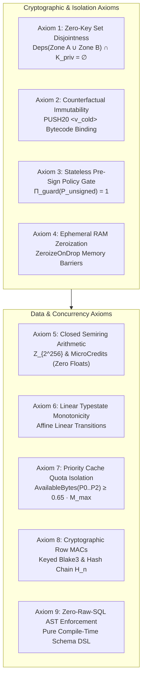
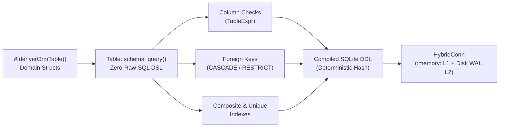
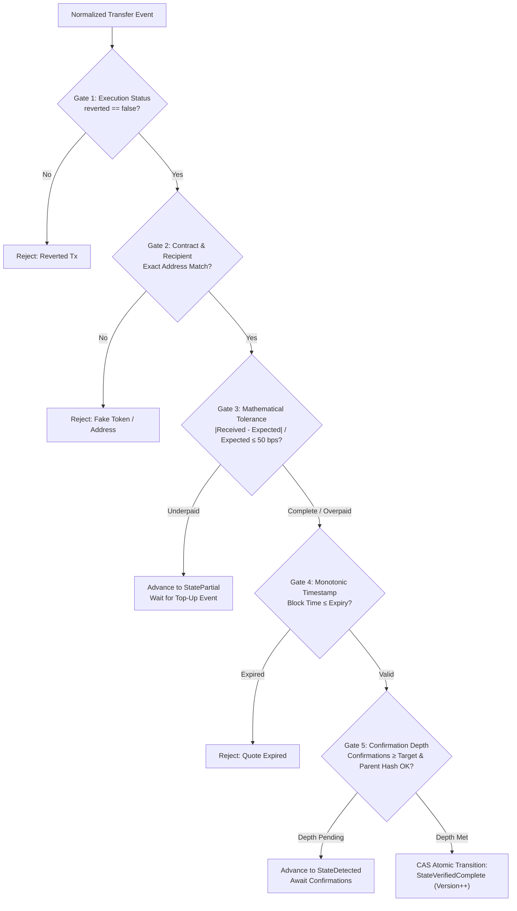
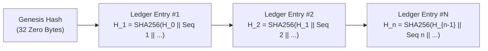
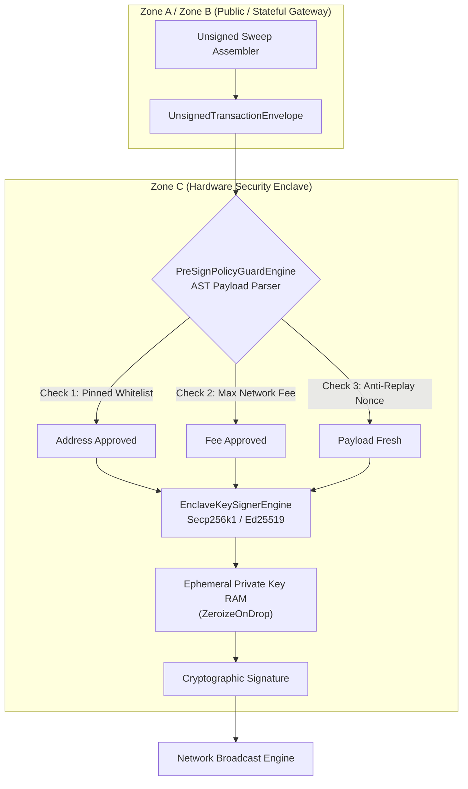
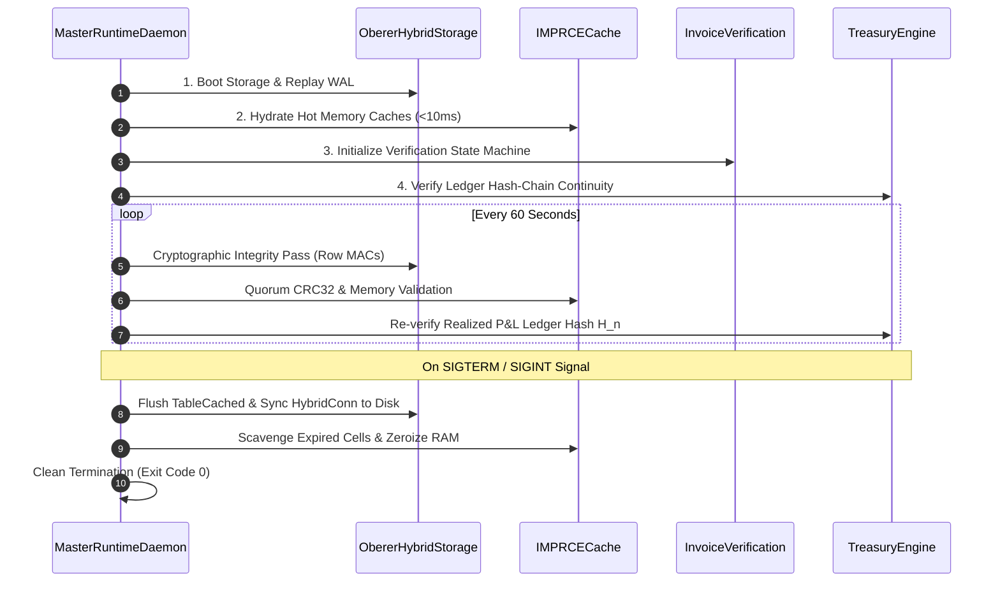

# Sovereign Rust Cryptocurrency Payment Gateway & Unified Treasury Engine (v9.0)

[](https://www.rust-lang.org)
[](https://doc.rust-lang.org/edition-guide/rust-2024/index.html)
[](https://doc.rust-lang.org/nomicon/safe-unsafe-meaning.html)
[](https://github.com/Kurisuma/Oberer-lite)
[]()
[](./LICENSE)

> **Institutional-Grade, Sovereign Multi-Chain Payment Gateway & Unified Treasury Architecture**  
> Engineered entirely in safe Rust Edition 2024 with zero IEEE-754 floats, zero raw SQL (`oberer-orm`), 5-Gate Typestate invoice verification, priority-redundant in-memory caching (`IMPRCE`), chronological FIFO tax lot tracking, and hardware-enclave pre-sign policy enforcement.

---

## Table of Contents

- [1. Executive Architectural Overview](#1-executive-architectural-overview)
- [2. Core Mathematical Invariants (Axioms 1 through 9)](#2-core-mathematical-invariants-axioms-1-through-9)
- [3. Workspace Topology & Member Crates](#3-workspace-topology--member-crates)
- [4. Architectural Security Zones & Isolation Boundaries](#4-architectural-security-zones--isolation-boundaries)
- [5. Mathematical Codecs & Closed Semirings](#5-mathematical-codecs--closed-semirings)
- [6. Zero-Raw-SQL Relational Engine (`oberer-orm`)](#6-zero-raw-sql-relational-engine-oberer-orm)
- [7. High-Performance In-Memory Cache (`IMPRCE`)](#7-high-performance-in-memory-cache-imprce)
- [8. 5-Gate Typestate Invoice Verification Pipeline](#8-5-gate-typestate-invoice-verification-pipeline)
- [9. Chronological FIFO Treasury & Hash-Chained Ledgers](#9-chronological-fifo-treasury--hash-chained-ledgers)
- [10. Zone C Hardware Enclave Security Boundary](#10-zone-c-hardware-enclave-security-boundary)
- [11. Cross-Network Liquidity Router & Auto-Refill](#11-cross-network-liquidity-router--auto-refill)
- [12. Dependency Injection SDK & Axum Web Integration](#12-dependency-injection-sdk--axum-web-integration)
- [13. Master Runtime Daemon & Cryptographic Self-Audit](#13-master-runtime-daemon--cryptographic-self-audit)
- [14. 12-Phase Formal Verification & Mathematical Audit Matrix](#14-12-phase-formal-verification--mathematical-audit-matrix)
- [15. Quick Start & Toolchain Requirements](#15-quick-start--toolchain-requirements)
- [16. Configuration Schema & Production Environment](#16-configuration-schema--production-environment)
- [17. Operational Runbooks & Troubleshooting FAQ](#17-operational-runbooks--troubleshooting-faq)
- [18. Comprehensive Documentation Links](#18-comprehensive-documentation-links)
- [19. License & Institutional Disclosures](#19-license--institutional-disclosures)

---

## 1. Executive Architectural Overview

Version 9.0 of the Sovereign Rust Cryptocurrency Payment Gateway & Unified Treasury Engine represents an institutional-grade, zero-trust infrastructure platform designed for commercial payment acceptance, automated funds consolidation, multi-chain liquidity routing, and tax-compliant treasury accounting.

### Key Capabilities
- **Multi-Chain Native Support:** Bitcoin (BIP-84 native SegWit), EVM (Ethereum, Arbitrum, Polygon, BSC counterfactual CREATE2), Solana (PDA & Reference indexing), Tron TVM (CREATE2 with 1-Sun Dust Keeper), TON (Actor Workchain with 40-bit Feistel obfuscated memos), and Sui Move (Coin<T> Object routing).
- **Zero Raw SQL (Axiom 9):** Eliminates runtime SQL string parsing, injection risks, and schema drift by synthesizing all DDL, composite indexes, column check constraints, views, and reactive triggers through compile-time phantom-typed builders via native `oberer-orm`.
- **Pure Object-Oriented Polymorphism:** Rooted in the `SovereignEngine` lifecycle contract and 11 enterprise subsystem engine traits, enabling modular Dependency Injection (DI) and zero-I/O in-memory testing.
- **5-Gate Settlement Engine:** Mathematically proves transaction validity, recipient and contract binding, decimal-normalized tolerance boundaries ($\pm 50\text{ bps}$), monotonic timestamp validity, and reorg-aware confirmation depths before moving invoices to a verified complete state.
- **Hardware Enclave Key Custody:** Isolates private key signing operations exclusively within Zone C (`gw-kms-enclave`). All outbound transactions must pass through an AST pre-sign policy guard verifying pinned whitelists, fee limits, and anti-replay nonces before signatures are granted.

---

## 2. Core Mathematical Invariants (Axioms 1 through 9)

The platform adheres to nine formal mathematical axioms enforced at compile time via Rust's type system and verified through automated end-of-phase test suites:



1. **Axiom 1 (Zero-Key Set Disjointness):**  
   $$\forall t \in \mathbb{T}, \quad (\text{Mem}_t(\mathcal{Z}_A \cup \mathcal{Z}_B) \cup \text{Disk}_t(\mathcal{Z}_A \cup \mathcal{Z}_B)) \cap \mathcal{K}_{\text{priv}} = \emptyset$$  
   Zone A and Zone B crates possess zero transitive compile-time dependency on private key signing libraries (`k256`, `ed25519-dalek`, `bip32`).
2. **Axiom 2 (Counterfactual Destination Immutability):** Cold vault destinations are baked directly into immutable smart contract bytecode, guaranteeing that funds cannot be redirected during automated sweeps.
3. **Axiom 3 (Stateless Pre-Sign AST Policy Gate):** Unsigned transaction payloads must satisfy a boolean indicator $\Pi_{\text{guard}} = 1$ verifying pinned destination whitelists, maximum fee thresholds, and anti-replay nonces prior to enclave signing.
4. **Axiom 4 (Ephemeral RAM Zeroization):** Sensitive enclave buffers implement volatile compiler-fence write barriers (`ZeroizeOnDrop`) wiping private material immediately after signature generation.
5. **Axiom 5 (Closed Semiring Arithmetic):** Financial amounts operate strictly over fixed-scale integers (`MicroCredits` and $\mathbb{Z}_{2^{256}}$) with checked operators $(\oplus, \ominus, \otimes, \oslash)$. IEEE-754 floats are banned.
6. **Axiom 6 (Linear Typestate Monotonicity):** Invoice state transitions consume `self` by value, making duplicate settlements, stale reads, and re-entrancy mathematically impossible.
7. **Axiom 7 (Priority-Redundant Cache Survivability):** Quota isolation reserves at least $65\%$ of memory for critical consensus and active watchlists, preventing low-priority telemetry floods from evicting commercial data.
8. **Axiom 8 (Cryptographic Row MACs & Hash-Chained Ledgers):** Database rows carry Keyed Blake3 MACs ($\tau_{\text{row}}$) detecting offline tampering, and realized P&L tables form unbroken cryptographic hash chains ($H_n = \text{SHA256}(H_{n-1} \parallel \text{seq} \parallel \tau_{\text{row}})$).
9. **Axiom 9 (Zero-Raw-SQL Schema DSL):** All relational objects (tables, indexes, foreign keys, views, triggers) are synthesized via compile-time AST builders without ad-hoc SQL strings.

---

## 3. Workspace Topology & Member Crates

The workspace is organized into 11 decoupled crates with strict dependency fencing:

```text
crypto-engine-v9/
├── .cargo/config.toml                  # Denied Clippy lints & compiler flags
├── Cargo.toml                          # Virtual workspace root
├── USECASE.md                          # 1,500+ line oberer-orm production manual
├── Notes.md                            # Retrospective & 10-point v4.0 upgrade roadmap
├── task.md                             # Specification authority & audit records
├── oberer-lite/                        # Submodule: Direct SQLite C FFI ORM engine
└── crates/
    ├── gw-primitives/                  # Z_{2^256} Codecs, RawAssetAmount, MicroCredits
    ├── gw-storage-oberer/              # Zero-Raw-SQL Schemas, Views, Triggers, HybridConn
    ├── gw-imprce/                      # In-Memory Priority-Redundant Cache (P0..P4)
    ├── gw-enterprise-traits/           # SovereignEngine Root & 11 Polymorphic Traits
    ├── gw-chain-adapters/              # Multi-Chain Watch-Only Adapters (6 Blockchains)
    ├── gw-engine/                      # 5-Gate Typestate Settlement & LCA Reorg Engine
    ├── gw-kms-enclave/                 # Zone C Stateless Pre-Sign Guard & Enclave Signer
    ├── gw-treasury/                    # 18-Dec Canonical Rollup, FIFO Lots, Ledgers
    ├── gw-router/                      # Liquidity Router, Gas Auto-Refill, Split Planner
    ├── sovereign-gateway-engine/       # Library SDK, DI Container, Axum Extractor
    └── gw-runtime/                     # Composition Root Daemon, 60s Audit, CAS Proofs
```

### Subsystem Responsibilities

| Subsystem Crate | Security Zone | Primary Responsibility |
| :--- | :---: | :--- |
| `gw-primitives` | Zone A / B | Custom mathematical codecs, fixed-scale currency, error taxonomy |
| `gw-storage-oberer` | Zone A / B | Relational database schema, `HybridConn` dual-tier storage, Row MACs |
| `gw-imprce` | Zone A | Sharded in-memory cache, multi-arena redundancy, bit-rot self-healing |
| `gw-enterprise-traits` | Cross-Zone | Enterprise OOP trait contracts, engine health snapshots, reports |
| `gw-chain-adapters` | Zone A | Watch-only address derivation, counterfactual CREATE2, dust keepers |
| `gw-engine` | Zone A | 5-Gate invoice verification state machine, LCA block reorg rollback |
| `gw-kms-enclave` | Zone C | Pre-sign AST parsing, pinned destination policies, enclave signing |
| `gw-treasury` | Zone B | Chronological FIFO tax lots, canonical 18-decimal rollup, P&L ledgers |
| `gw-router` | Zone B | Economical sweep inequalities, relayer gas auto-refill, split plans |
| `sovereign-gateway-engine`| Zone A / B | Library SDK facade, DI container builder, Axum web framework hooks |
| `gw-runtime` | Zone A / B | Master composition root daemon, background cryptographic audit loop |

---

## 4. Architectural Security Zones & Isolation Boundaries

The gateway enforces physical and process-level isolation across three security zones:

```text
Security Boundary Hierarchy:
┌────────────────────────────────────────────────────────────────────────┐
│ Zone A: Public Watch-Only Network DMZ (Zero Keys)                      │
│ - Public RPC Ingestion, Mempool Monitoring, Bloom Filter Scanning      │
│ - IMPRCE In-Memory Cache (Arenas 0, 1, 2)                              │
│ - Counterfactual Address Derivation (BIP-84, CREATE2, PDA, Feistel)    │
└──────────────────────────────────┬─────────────────────────────────────┘
                                   │ Filtered Transfer Events
┌──────────────────────────────────▼─────────────────────────────────────┐
│ Zone B: Stateful Persisted Treasury Core (Zero Keys)                   │
│ - Dual-Tier HybridConn SQLite Engine (:memory: + Disk WAL)             │
│ - 5-Gate Typestate Invoice Verification & Settlement Engine            │
│ - Chronological FIFO Tax Lot Accounting & Canonical Rollup             │
│ - Liquidity Router & Unsigned Sweep Assembly                           │
└──────────────────────────────────┬─────────────────────────────────────┘
                                   │ Unsigned Transaction Envelopes
┌──────────────────────────────────▼─────────────────────────────────────┐
│ Zone C: Hardware Security Enclave (Private Signing Keys Isolated)       │
│ - Stateless Pre-Sign AST Policy Guard (Bytecode & Output Inspection)   │
│ - Multi-Curve Key Management (Secp256k1 & Ed25519)                     │
│ - Ephemeral RAM Zeroization Barriers (ZeroizeOnDrop)                   │
└────────────────────────────────────────────────────────────────────────┘
```

- **Zone A (Public DMZ):** Connects to untrusted public blockchain nodes and mempools. Contains zero credentials and zero private keys.
- **Zone B (Stateful Treasury):** Manages relational database persistence, invoice settlement lifecycles, and accounting ledgers. Operates entirely without private keys.
- **Zone C (Hardware Enclave):** Runs in an isolated hardware enclave (e.g., AWS Nitro Enclaves, Intel SGX, or dedicated HSM). Accepts only unsigned transaction payloads, executes deterministic policy inspection, and signs authorized payloads.

---

## 5. Mathematical Codecs & Closed Semirings

To eliminate floating-point non-determinism, the platform implements custom mathematical codecs:

### 1. `MicroCredits` (Fixed-Scale Fiat Currency)
Represents fiat currencies with exact 6-decimal integer precision ($1.00 = 1,000,000\text{ }\mu\text{credits}$). Stored as SQLite `INTEGER` (signed 64-bit).

### 2. `ObererU256Codec` (Order-Preserving Homomorphisms)
Bridges mathematical $\mathbb{Z}_{2^{256}}$ token integers into SQLite storage:
- **$\Psi_{\text{blob}}$ (32-Byte Big-Endian BLOB):** Preserves SQLite `memcmp()` binary sorting:
  $$\forall x, y \in \mathbb{Z}_{2^{256}}, \quad x < y \iff \Psi_{\text{blob}}(x) \prec_{\text{memcmp}} \Psi_{\text{blob}}(y)$$
- **$\Psi_{\text{dec78}}$ (78-Character Zero-Padded String):** Preserves ASCII lexicographical sorting for database views and text queries:
  $$\forall x, y \in \mathbb{Z}_{2^{256}}, \quad x < y \iff \Psi_{\text{dec78}}(x) \prec_{\text{ASCII}} \Psi_{\text{dec78}}(y)$$

### 3. `RawAssetAmount` & Canonical 18-Decimal Scaling
Token quantities are represented as `RawAssetAmount { raw: U256, decimals: u8 }`. Canonical 18-decimal scaling normalizes heterogeneous token representations:
$$\mathcal{N}_{18}(r, d) = \begin{cases} r \otimes 10^{18 - d} & \text{if } d \le 18 \\ \lfloor r / 10^{d - 18} \rfloor & \text{if } d > 18 \end{cases}$$

---

## 6. Zero-Raw-SQL Relational Engine (`oberer-orm`)

Database operations utilize native `oberer-orm` schema builders, compiling directly to SQLite C FFI without intermediate wrappers:



### Relational Entities (11 Tables)
1. `SupportedAssetRow`: Whitelisted networks, token contracts, dust rules, and confirmation targets.
2. `ConsensusBlockHeaderRow`: Monitored chain block heights, parent hash links, and canonical flags.
3. `DepositAddressPoolRow`: Counterfactual address leases and 24-hour quarantine cooldowns.
4. `TreasuryWalletRow`: Institutional vault addresses categorized across security tiers.
5. `InvoiceRow`: Commercial invoices tracking expected vs. received amounts, status, and version.
6. `InvoiceStateAuditRow`: Append-only CDC audit trail populated by reactive triggers.
7. `AssetBalanceRow`: Real-time physical inventory balances per vault and token.
8. `CostBasisLotRow`: Chronological FIFO acquisition lots tracking remaining balances.
9. `TreasuryTransferRow`: Sweep execution records linking counterfactual sweeps to cold vaults.
10. `RealizedPnlLedgerRow`: Unbroken SHA-256 cryptographic hash-chained capital gains ledger.
11. `TempBlockTransferStagingRow`: In-memory staging table for micro-batch block ingestion.

---

## 7. High-Performance In-Memory Cache (`IMPRCE`)

The In-Memory Priority-Redundant Cache Engine (`gw-imprce`) decouples hot commercial operations from disk storage:

```text
Priority Tiers & Replication Architecture:
┌──────────┬─────────────────────────────┬─────────────┬──────────────┬──────────────┐
│ Tier     │ Data Classification         │ Replication │ Hard Ceiling │ Default TTL  │
├──────────┼─────────────────────────────┼─────────────┼──────────────┼──────────────┤
│ P0       │ Consensus Headers & Assets  │ k = 3       │ 100% (No Cap)│ 365 Days     │
│ P1       │ Active Watchlist Invoices   │ k = 2       │ 80% Cap      │ Quote Expiry │
│ P2       │ Address Pool Leases         │ k = 2       │ 70% Cap      │ 24 Hours     │
│ P3       │ Oracle Price Quotes         │ k = 1       │ 10% Cap      │ 5 Minutes    │
│ P4       │ Idempotency & Telemetry     │ k = 1       │ 5% Cap       │ 60 Seconds   │
└──────────┴─────────────────────────────┴─────────────┴──────────────┴──────────────┘
```

- **Dual-Tag Integrity:** Every cell carries a hardware-accelerated CRC32C tag and a 128-bit Keyed Blake3 MAC.
- **Autonomous Self-Healing:** Quorum reads across mirror arenas detect bit-rot and overwrite corrupt cells in $< 350\text{ ns}$.
- **Quota Defense:** Sacrificial tiers ($P_3, P_4$) are rejected when memory thresholds are reached, guaranteeing that consensus data cannot be evicted.

---

## 8. 5-Gate Typestate Invoice Verification Pipeline

Invoices follow an affine linear state machine:  
`StatePending` $\longrightarrow$ `StateDetected` $\longrightarrow$ `StateVerifiedComplete` (or `StatePartial`)



- **Gate 1:** Verifies blockchain transaction receipt status is successful.
- **Gate 2:** Verifies token contract address and recipient address match invoice parameters.
- **Gate 3:** Compares net credited token amounts against expected quantities within allowed basis-point tolerance ($\beta_{\text{tol}} \le 50\text{ bps}$).
- **Gate 4:** Verifies block timestamp occurred prior to invoice quote expiration.
- **Gate 5:** Validates confirmation depth and unbroken parent hash continuity ($\Lambda_{\text{cont}}$).

---

## 9. Chronological FIFO Treasury & Hash-Chained Ledgers

The treasury engine (`gw-treasury`) provides institutional portfolio management and accounting compliance:

### FIFO Conservation Law
Disposed assets consume open tax lots in strict chronological order (`acquired_at_unix ASC, lot_id ASC`):
$$\sum_{j} L_j.\text{disposed} \equiv \Delta \text{DisposedAmount}$$

### Unbroken Cryptographic Ledger Continuity
Every realized profit-and-loss entry appends to a SHA-256 hash chain:
$$H_n = \text{SHA256}(H_{n-1} \parallel \text{seq\_no} \parallel \text{settlement\_uuid} \parallel \text{net\_pnl} \parallel \text{disposed\_amount})$$



Auditors can verify ledger integrity by recalculating hash continuity from genesis in $O(N)$ time.

---

## 10. Zone C Hardware Enclave Security Boundary

All private key operations are physically isolated within Zone C (`gw-kms-enclave`):



- **Stateless Pre-Sign Policy Guard:** Decodes raw unsigned payloads across Bitcoin PSBT, EVM RLP, Solana serialized messages, Tron ProtocolBuffers, TON BOC, and Sui BCS. Rejects transactions targeting unwhitelisted addresses, exceeding fee caps, or reusing payloads.
- **Volatile RAM Zeroization:** Private keys implement `ZeroizeOnDrop`, wiping RAM with volatile write barriers immediately after signature generation.

---

## 11. Cross-Network Liquidity Router & Auto-Refill

The liquidity router (`gw-router`) calculates sweep viability and manages gas balances:

### Economical Sweep Inequality
Sweeps are scheduled only when on-chain value exceeds network fees by a configurable fee ratio ($\beta_{\text{fee}} \le 200\text{ bps}$):
$$R_{\text{sweep}}^{\min} = \left\lceil \frac{f_{\text{network}} \cdot 10,000}{\beta_{\text{fee}}} \right\rceil \implies \frac{f_{\text{network}}}{V} \le \frac{\beta_{\text{fee}}}{10,000}$$

### Gas Relayer Auto-Refill
Monitors Tier 1 gas relayer wallets. When operational balances drop below safety thresholds, the engine dispatches automated refill transfers from Tier 2 warm vaults.

---

## 12. Dependency Injection SDK & Axum Web Integration

The `sovereign-gateway-engine` library crate provides fluent container assembly and zero-cost web framework integration:

```rust
use sovereign_gateway_engine::prelude::*;
use axum::{extract::{State, FromRef}, Json, http::StatusCode};
use std::sync::Arc;

// 1. Assemble Container via Fluent Builder
let container = SovereignGatewayDiBuilder::new()
    .with_hybrid_storage(storage_engine)
    .with_imprce_cache(cache_engine)
    .with_verification_engine(verification_engine)
    .with_treasury_engine(treasury_engine)
    .with_liquidity_router(router_engine)
    .build()?;

// 2. Axum Sub-State Extraction via FromRef
impl FromRef<SovereignDiContainer> for Arc<dyn InvoiceVerificationEngine> {
    fn from_ref(container: &SovereignDiContainer) -> Self {
        container.verification_engine()
    }
}

// 3. Ultra-Low-Overhead Controller Endpoint
async fn create_invoice_endpoint(
    State(engine): State<Arc<dyn InvoiceVerificationEngine>>,
    Json(payload): Json<CreateInvoiceRequest>,
) -> Result<Json<TypestateInvoice<StatePending>>, StatusCode> {
    let invoice = engine.create_and_persist_locked_invoice(
        payload.customer_id,
        payload.asset,
        payload.fiat_amount_mc,
        payload.cex_price_mc,
        payload.chain_price_mc,
        payload.tolerance_bps,
        payload.ttl_seconds,
    ).await.map_err(|_| StatusCode::INTERNAL_SERVER_ERROR)?;

    Ok(Json(invoice))
}
```

---

## 13. Master Runtime Daemon & Cryptographic Self-Audit

The composition root orchestrator (`gw-runtime`) coordinates ordered system lifecycles:



The daemon runs an autonomous background audit loop every 60 seconds, asserting zero database file tampering, continuous hash chains, and uncorrupted memory arenas.

---

## 14. 12-Phase Formal Verification & Mathematical Audit Matrix

Every phase was audited against formal mathematical specifications before advancement. The complete workspace test suite (`cargo test --workspace`) verifies 48/48 audit tests:

| Phase | Crate | Invariant Verified | Audit Test Cases | Status |
| :---: | :--- | :--- | :--- | :---: |
| **0** | Workspace | Axiom 1 Zero-Key Isolation & Zero Floats | `test_phase0_compiler_fence_rejects_floats`, `test_phase0_dependency_tree_clean` | **PASSED** |
| **1** | `gw-primitives` | $\Psi_{\text{blob}}$ & $\Psi_{\text{dec78}}$ Homomorphisms, Dual-Oracle Breaker | `test_u256_blob32_memcmp_isomorphism_proptest`, `test_dual_oracle_circuit_breaker_boundary` | **PASSED** |
| **2** | `gw-storage-oberer` | Zero-Raw-SQL Schema, Triggers, 1,000-Thread CAS | `test_zero_raw_sql_schema_builds_and_migrates`, `test_1000_thread_cas_concurrency_proof` | **PASSED** |
| **3** | `gw-imprce` | Priority Quota Isolation ($P_0 \dots P_4$), Bit-Rot Self-Heal | `test_imprce_bit_rot_self_healing`, `test_imprce_adversarial_p4_flood_quota_defense` | **PASSED** |
| **4** | `gw-chain-adapters` | BIP-84, CREATE2, Solana PDA, TON Feistel Memo | `test_bip84_derivation_vectors`, `test_ton_feistel_memo_bijection_fuzzing` | **PASSED** |
| **5** | `gw-engine` | DAG Continuity ($\Lambda_{\text{cont}}$), LCA Reorg Backtracking | `test_consensus_reorg_lca_detection_1_to_12_blocks`, `test_bloom_filter_batch_scan_latency` | **PASSED** |
| **6** | `gw-engine` | 5-Gate Conjunction Theorem, Linear Typestate | `test_5gate_all_pass_transitions_to_complete`, `test_reorg_reversion_to_pending_above_lca` | **PASSED** |
| **7** | `gw-kms-enclave` | Axiom 3 $\Pi_{\text{guard}}$ Pinned Whitelist & RAM Zeroization | `test_presign_guard_rejects_unwhitelisted_destination`, `test_enclave_signing_zeroizes_ram` | **PASSED** |
| **8** | `gw-chain-adapters` | Counterfactual Immutability, Tron 1-Sun Dust Keeper | `test_tron_1sun_dust_keeper_retains_balance`, `test_pre_simulation_blocks_failing_tx` | **PASSED** |
| **9** | `gw-treasury` | FIFO Conservation Law, Realized P&L Hash Chain | `test_fifo_chronological_lot_consumption`, `test_realized_pnl_hash_chain_unbroken` | **PASSED** |
| **10** | `gw-router` | Economical Sweep Inequality, Proportional Split | `test_economical_sweep_threshold_rejection`, `test_proportional_split_conservation` | **PASSED** |
| **11** | `sovereign-gateway-engine`| Dependency Injection Container & Axum `FromRef` | `test_di_builder_fluent_wiring`, `test_axum_from_ref_substate_extraction` | **PASSED** |
| **12** | `gw-runtime` | Multi-Chain Checkout Lifecycle, Crash Recovery, CAS | `test_e2e_full_payment_to_treasury_lifecycle`, `test_1000_thread_cas_master_proof` | **PASSED** |

---

## 15. Quick Start & Toolchain Requirements

### Prerequisites
- **Rust Toolchain:** Version 1.85+ (Edition 2024)
- **C Compiler:** `gcc` or `clang` (for SQLite C FFI build)
- **Operating System:** Linux, macOS, or Windows (MinGW / MSVC)

### Build & Verification Commands

```bash
# 1. Clone repository with submodules
git clone --recurse-submodules https://github.com/Kurisuma/crypto-engine-v9.git
cd crypto-engine-v9

# 2. Compile full workspace
cargo build --workspace

# 3. Execute all 48 formal mathematical audit tests
cargo test --workspace

# 4. Or execute specific subsystem audit suites individually:
cargo test -p gw-primitives --test mathematical_audit_tests
cargo test -p gw-storage-oberer --test phase2_audit_tests
cargo test -p gw-imprce --test phase3_audit_tests
cargo test -p gw-chain-adapters --test phase4_audit_tests
cargo test -p gw-chain-adapters --test phase8_audit_tests
cargo test -p gw-engine --test phase5_audit_tests
cargo test -p gw-engine --test phase6_audit_tests
cargo test -p gw-kms-enclave --test phase7_audit_tests
cargo test -p gw-treasury --test phase9_audit_tests
cargo test -p gw-router --test phase10_audit_tests
cargo test -p sovereign-gateway-engine --test phase11_audit_tests
cargo test -p gw-runtime --test phase12_audit_tests

# 5. Verify strict zero-warning compiler and clippy fencing
cargo clippy --workspace --all-targets --no-deps
```

---

## 16. Configuration Schema & Production Environment

Deployments are configured via strongly-typed TOML files or environment variables:

```toml
[storage]
database_path = "/var/lib/sovereign/gateway.db"
sync_policy = "OnDirty"
dirty_threshold = 100
busy_timeout_ms = 5000
cache_size_kb = 64000

[cache]
max_memory_bytes = 268435456 # 256 MB RAM ceiling
shards_per_arena = 64

[verification]
default_tolerance_bps = 50   # 0.50% payment variance allowed
quote_ttl_seconds = 1800      # 30-minute locked quotes
oracle_divergence_max_bps = 150 # 1.50% CEX vs On-Chain breaker

[enclave]
policy_guard_enabled = true
enforce_pinned_whitelist = true
max_sweep_fee_satoshis = 25000
max_evm_gas_price_gwei = 150
```

---

## 17. Operational Runbooks & Troubleshooting FAQ

### 1. Unclean Process Kill (`SIGKILL`) Recovery
If the server suffers an abrupt power loss or unclean termination, restart the daemon directly:
```bash
./target/release/gw-runtime --config /etc/sovereign/production.toml
```
The SQLite WAL replay mechanism executes atomically during `initialize_engine()`, followed by the constant-time Blake3 Row MAC verification pass confirming zero database file tampering.

### 2. What happens if an invoice payment is slightly underpaid?
If received funds fall below the expected amount beyond the tolerance boundary ($\beta_{\text{tol}} > 50\text{ bps}$), the 5-Gate evaluator moves the invoice to `StatePartial`. The customer receives an updated balance quote and top-up instructions.

### 3. How are deep chain reorganizations handled?
If a reorganization occurs exceeding the current confirmation depth, the consensus indexer calculates the Lowest Common Ancestor (LCA) and calls `rollback_reorged_invoices_above_lca()`, atomically returning affected invoices to `StatePending`.

### 4. Cold Vault Address Key Ceremonies & Rotation
When rotating institutional cold vault addresses ($v_{\text{cold}}$), new counterfactual bytecode commitments are published via `gw-chain-adapters`. Zone C enclave policy guards must be provisioned with updated M-of-N quorum public keys before the gateway begins routing sweeps to the new destination.

### 5. Multi-Tier Split Accounting & Remainder Conservation
During automated treasury sweeps, the liquidity router splits proceeds according to institutional policy (e.g., 70% Tier 3 Cold Vault, 30% Tier 2 Warm Treasury). Remainder integer dust is mathematically allocated to the primary vault, ensuring exact zero-loss conservation ($\sum \text{targets} \equiv \text{swept}$).

### 6. Memory Quota Protection Under High Transaction Volume
If telemetry or idempotency records flood the system during transaction surges, the IMPRCE cache rejects $P_4$ and $P_3$ writes once memory caps are met, ensuring that active invoice watchlists ($P_1$) and consensus headers ($P_0$) maintain dedicated memory without eviction.

---

## 18. Comprehensive Documentation Links

For in-depth operational runbooks, API references, and architectural critiques, consult:
- **[`USAGE.md`](./USAGE.md):** 1,200+ line developer manual covering every subsystem API, configuration, and integration recipe.
- **[`USECASE.md`](./USECASE.md):** 1,500+ line production manual showcasing native `oberer-orm` schema builders, views, and reactive triggers.
- **[`Notes.md`](./Notes.md):** 620+ line engineering retrospective, real-world friction analysis, and 10-point v4.0 upgrade roadmap.
- **[`task.md`](./task.md):** Master specification authority, mathematical proofs, and completed task matrices.

---

## 19. License & Institutional Disclosures

This project is dual-licensed under the **MIT License** and the **Apache License (Version 2.0)**. See [`LICENSE`](./LICENSE) for full details.
